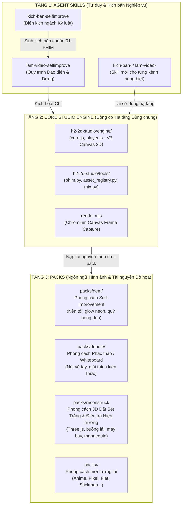

# 🧭 HƯỚNG DẪN KIẾN TRÚC & MỞ RỘNG CHỦ ĐỀ, PHONG CÁCH MỚI

> [!IMPORTANT]
> **QUY TRÌNH SẢN XUẤT CHUẨN ĐÃ ĐƯỢC CHUẨN HÓA TẠI [MASTER_SOP.md](file:///d:/project%20workspace/ContentYTBapp/MASTER_SOP.md):**  
> Mọi bước thực thi sản xuất từ Kịch bản -> Voice -> Asset Audit -> Render -> Mix -> QC Gate bắt buộc thực hiện qua Master CLI:  
> `py -X utf8 tools/produce.py --project projects/<slug> [--pack dem|doodle|reconstruct]`

Tài liệu này giải thích bản chất kiến trúc 3 tầng của hệ thống sản xuất hoạt hình tự động, vai trò của các Skill hiện tại, và cẩm nang hướng dẫn từng bước khi bạn muốn **mở rộng sang các kênh, chủ đề hoặc phong cách đồ họa hoàn toàn mới**.

---

## 1. 🏗️ KIẾN TRÚC 3 TẦNG CỐT LÕI (THE 3-TIER ARCHITECTURE)

Hệ thống được thiết kế theo nguyên lý **Phân tách Trách nhiệm (Separation of Concerns - SoC)**. Bạn không bao giờ phải "đập đi xây lại" toàn bộ hệ thống khi muốn làm một nội dung mới.



---

## 2. 🧩 VAI TRÒ CỦA CÁC SKILL HIỆN TẠI

Hai thư mục trong `.agents/skills/` chính là **SOP (Quy trình chuẩn hóa)** và **Persona chuyên gia** của AI:

### 1. `kich-ban-selfimprove` — Vai trò: Biên kịch & Chiến lược gia Nội dung
- **Bản chất:** Đóng gói toàn bộ bí quyết (formula) của dòng phim Self-Improvement:
  - Nghiên cứu đề tài: Nghiện điện thoại, trì hoãn, dopamine, tái nghiện, kỷ luật.
  - Cấu trúc 6 nhịp kịch tính: *Cám dỗ -> Vấp ngã -> Sụp đổ về 0 -> Bừng tỉnh -> Kỷ luật*.
  - Định dạng kịch bản: Chữ trên hình tiếng Anh, giọng cám dỗ thì thầm, bộ đếm `DAY N`.
  - Gói SEO xuất bản: 10 Tiêu đề YouTube, 3 ý tưởng Thumbnail, Description, Tags.
- **Đầu ra:** File kịch bản chuẩn hóa `01-PHIM-<slug>.txt`.

### 2. `lam-video-selfimprove` — Vai trò: Đạo diễn & Nhà sản xuất Phim Hoạt hình
- **Bản chất:** Cung cấp hướng dẫn từng bước để AI vận hành bộ máy `h2-2d-studio`:
  - Đọc file `01-PHIM` -> Tự động phân cảnh điện ảnh và kiểm toán tài nguyên (`tools/phim.py`).
  - Điều khiển camera creep-in zoom, rung lắc màn hình (camera shake), bố cục 1/3.
  - Render từng khung hình 2D phẳng trực tiếp bằng mã nguồn qua Chromium (`render.mjs`).
  - Hòa âm đa kênh (nhạc nền, SFX đồng bộ từng khung hình) đạt chuẩn -14 LUFS (`tools/mix.py`).

> [!NOTE]
> **Hiện tại:** 2 skill này đang được cấu hình mặc định để sử dụng pack `dem`. Nhưng **Studio Engine bên dưới là hoàn toàn trung lập (Pack-Agnostic)** và có thể phục vụ bất kỳ phong cách nào.

---

## 3. ⚖️ NGUYÊN TẮC BẮT BUỘC: MỖI NGÁCH PHẢI ĐI THEO MỘT CẶP SKILL RIÊNG BIỆT

Một sai lầm phổ biến là cố gắng dùng chung một bộ Skill (như `selfimprove`) cho mọi thể loại video. Khi bạn chuyển sang một phong cách hình ảnh hoặc ngách nội dung khác (ví dụ: chuyển từ **`dem`** sang **`doodle`**), **bắt buộc phải tạo một CẶP SKILL mới**.

### 🔍 So sánh thực tế: Hai "thế giới" đối lập giữa `dem` và `doodle`

| Đặc điểm cốt lõi | Pack `dem` (Ngách Self-Improvement) | Pack `doodle` (Ngách Giải thích / "Vì sao...") |
| :--- | :--- | :--- |
| **Bản chất thể loại** | **Phim ngắn câm nghệ thuật (Silent Film)** | **Video giải thích kiến thức (Explainer Video)** |
| **Giọng đọc (Voiceover)** | ❌ **Tuyệt đối KHÔNG có lời đọc**. Kể chuyện bằng hình và chữ. | ✅ **BẮT BUỘC có giọng đọc (Voiceover/TTS)** dẫn dắt xuyên suốt. |
| **Phụ đề & Chữ** | Chữ kể chuyện tối giản in hoa, chữ cám dỗ viết tay rực đỏ. | Phụ đề chữ vàng viền đen (`#ffd84a`), **nhấp nháy đồng bộ theo từng từ người nói** (*word-sync karaoke*). |
| **Màu sắc & Phông nền** | Nền tối đen kịt (`#0a0a0c`), ánh sáng neon u tối, tương phản cao. | Nền giấy vẽ màu pastel ấm, nét mực đen dày giả lập vẽ tay (`ink.js`). |
| **Tài nguyên hình ảnh** | Giường ngủ, điện thoại phát sáng, bóng quỷ đen, bộ đếm `DAY N`. | Người dẫn chuyện (Host/Caveman), bản đồ thế giới (`map.js`), biểu đồ, nét phác thảo (`sketch.js`). |
| **Âm thanh (Audio)** | Nhạc piano u uất, tiếng đồng hồ tích tắc, tiếng thì thầm ma mị. | Giọng đọc AI, tiếng bút sột soạt trên giấy (`pencil_scratch`), nhạc nền tò mò (`curious`). |

### ⚠️ Hậu quả nếu dùng sai Skill:
- **Gây "loãng não" và xung đột context của AI (Prompt Confusion):** Skill `selfimprove` ép chặt các quy tắc *"Bộ đếm ngày, bóng ma cám dỗ, sụp đổ về 0, không được dùng voice"*. Nếu dùng nó để làm video giải thích khoa học hoặc lịch sử bằng pack `doodle`, AI sẽ cố nhét bóng ma cám dỗ và bộ đếm ngày vào bài giảng khoa học!
- **Lệch pha phân cảnh (Storyboarding Mismatch):** Bộ chuyển đổi phân cảnh sẽ cố tìm các pose như `lying_phone`, `devil_tower` thay vì tìm `host_point`, `map_zoom`, `draw_chart`.

### 💡 Quy chuẩn thiết kế Cặp Skill:
Mỗi một ngách nội dung / phong cách đặc thù khi triển khai trên `h2-2d-studio` phải đi theo đúng **cặp bài trùng**:
1. **`kich-ban-<ngach>` (Pre-production):** Chịu trách nhiệm về tư duy đề tài, cấu trúc nhịp điệu của thể loại đó (có voice hay không voice, cách chia timeline, phong cách thumbnail).
2. **`lam-video-<ngach>` (Production):** Chịu trách nhiệm điều khiển `h2-2d-studio` với cờ `--pack <pack_tuong_ung>`, ánh xạ đúng thư viện mẫu cảnh của pack đó và hòa âm đúng phong cách.

---

## 4. 🚦 BẢNG MA TRẬN QUYẾT ĐỊNH (DECISION MATRIX)

Khi bạn nảy ra một ý tưởng mới, hãy đối chiếu với bảng sau để biết mình cần làm gì:

| Mong muốn của bạn | Cần tạo Pack mới? | Cần tạo Cặp Skill mới? | Sửa Core Studio? |
| :--- | :---: | :---: | :---: |
| **1. Đổi chủ đề trong cùng thể loại** (Ví dụ: Từ *Cai nghiện điện thoại* sang *Kỷ luật thức dậy 5h sáng*) | ❌ Không | ❌ Không (Dùng luôn cặp skill `selfimprove`) | ❌ Không |
| **2. Giữ ngách Self-Improvement nhưng muốn đổi phong cách vẽ** (Ví dụ: Vẽ bằng Pixel Art thay vì Flat Neon) | ✅ **CÓ** (Tạo `packs/pixel`) | ❌ Không (Chỉ truyền `--pack pixel`) | ❌ Không |
| **3. Triển khai phong cách `doodle` (Kênh Giải thích, Tóm tắt sách, Khoa học)** | ❌ Không (Đã có sẵn `packs/doodle`) | ✅ **CÓ** (Tạo cặp `kich-ban-doodle` & `lam-video-doodle`) | ❌ Không |
| **4. Mở Kênh hoàn toàn mới cả nội dung lẫn đồ họa** (Ví dụ: Kênh Lịch sử hoạt hình Anime) | ✅ **CÓ** (Tạo `packs/anime`) | ✅ **CÓ** (Tạo cặp `kich-ban-history` & `lam-video-history`) | ❌ Không |

---

## 5. 🛠️ CẨM NANG THỰC HIỆN TỪNG BƯỚC

### KỊCH BẢN 1: TẠO PHONG CÁCH ĐỒ HỌA MỚI (TẠO PACK MỚI)

Nếu bạn muốn tạo một phong cách đồ họa mới (ví dụ: `packs/pixel` hoặc `packs/cyber`):

1. **Khởi tạo thư mục pack:**
   ```
   h2-2d-studio/packs/<ten_pack>/
   ├── pack.js          # Định nghĩa màu sắc chủ đạo, font chữ, quy tắc render
   ├── sets.js          # Thư viện bối cảnh (phòng ngủ, đường phố, văn phòng...)
   ├── props.js         # Thư viện đạo cụ (điện thoại, sách, đồng hồ, xe...)
   ├── actors.js        # Thư viện nhân vật & tư thế (đứng, ngồi, chạy, khóc...)
   └── templates.js     # Thư viện bố cục cảnh mẫu (Shot templates)
   ```
2. **Tuân thủ quy tắc đặt tên Canonical (Bắt buộc):**
   - 100% tên tài nguyên phải viết bằng **Tiếng Anh** dạng `snake_case` (ví dụ: `bedroom_night`, `holding_phone`).
   - Tên tiếng Việt chỉ dùng làm `aliases` để đối chiếu kịch bản.
3. **Đăng ký vào Asset Registry:**
   Chạy lệnh để hệ thống tự động nhận diện tài nguyên của pack mới:
   ```bash
   py -X utf8 tools/asset_registry.py --add-pack <ten_pack>
   ```
4. **Sử dụng:**
   Khi tạo dự án, chỉ định pack mới:
   ```bash
   py -X utf8 tools/new_project.py --name video_moi --pack <ten_pack>
   ```

---

### KỊCH BẢN 2: MỞ KÊNH / NGÁCH NỘI DUNG MỚI (TẠO SKILL MỚI)

Nếu bạn muốn mở một kênh YouTube mới (ví dụ: Kênh **"Tóm tắt sách & Tư duy" - Explainer**):

1. **Tạo 2 thư mục Skill trong `.agents/skills/`:**
   - `.agents/skills/kich-ban-explainer/` (Biên kịch)
   - `.agents/skills/lam-video-explainer/` (Dựng phim)

2. **Thiết lập file `SKILL.md` cho Biên kịch (`kich-ban-explainer`):**
   - Định nghĩa đối tượng khán giả và phong cách viết (Tone & Voice).
   - Thiết lập cấu trúc kịch bản mới: Thay vì 6 nhịp "Cám dỗ - Sụp đổ về 0", kịch bản tóm tắt sách sẽ theo công thức: *Hook đặt vấn đề -> Luận điểm 1 -> Luận điểm 2 -> Ví dụ thực tế -> Bài học ứng dụng (Actionable Takeaway)*.
   - Thêm phần kịch bản lời đọc Voiceover nếu kênh có sử dụng giọng nói.

3. **Thiết lập file `SKILL.md` cho Dựng phim (`lam-video-explainer`):**
   - Hướng dẫn AI gọi lệnh studio với phong cách phù hợp (ví dụ: `--pack doodle`).
   - Quy định tỷ lệ khung hình: 16:9 cho video dài hoặc 9:16 cho YouTube Shorts.
   - Hướng dẫn sử dụng âm thanh phù hợp (Nhạc lofi nhẹ nhàng, tiếng bút vẽ sột soạt `sfx: pencil_draw`).

4. **Kích hoạt sử dụng:**
   - Trong cuộc trò chuyện với trợ lý AI, bạn chỉ cần gõ:
     > *"Dùng skill `/kich-ban-explainer` viết kịch bản tóm tắt cuốn sách Atomic Habits"*
     > *"Dùng skill `/lam-video-explainer` dựng video từ kịch bản vừa tạo"*

---

## 6. 💡 NGUYÊN TẮC VÀNG ĐỂ HỆ THỐNG LUÔN ỔN ĐỊNH

1. **Bảo vệ Core Engine:** Không bao giờ sửa đổi logic lõi trong `h2-2d-studio/engine/core.js` chỉ để phục vụ riêng một video đơn lẻ. Mọi tùy biến hình ảnh phải nằm trong `packs/` hoặc `scenes/shots/<id>.js`.
2. **Quy chuẩn Âm thanh Bất biến:** Mọi video hoàn thiện khi xuất bản đều phải qua `tools/mix.py` để chuẩn hóa **-14 LUFS** (chuẩn YouTube quốc tế, không bị nền tảng tự động bóp nhỏ âm lượng).
3. **Thư viện Tái sử dụng:** Bất kỳ asset nào (bối cảnh, đạo cụ) vẽ ra cho video hôm nay nên được đưa vào `packs/<pack>/` để video ngày mai tái sử dụng mà không cần vẽ lại từ đầu.
